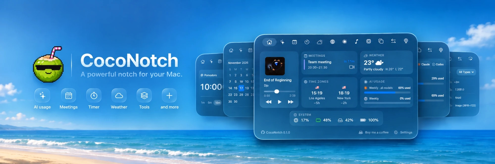

<p align="center">
  
</p>

<p align="center">
  Your MacBook notch, turned into a hub for the workday: meetings, music, timers, clipboard history, a file shelf and more, one hover away.
</p>

<p align="center">
  
  <a href="https://github.com/juangarcia-ts/coconotch/releases/latest"></a>
  <a href="LICENSE"></a>
</p>

## Why CocoNotch

- **Built for the workday.** Join your next meeting, run a Pomodoro, find something you copied an hour ago or keep a file at hand, all from the notch you already look at.
- **Make it yours.** Turn widgets on or off, drag them into the order you want and tune each one in Settings.
- **Private where it can be.** Ask runs on your Mac with Apple Intelligence, and everything else stays on your Mac unless a widget needs a service, listed under [Privacy](#privacy).
- **Free and open source,** under [GPL-3.0](LICENSE).

## Install

```sh
brew install --cask juangarcia-ts/tap/coconotch
```

Or download `CocoNotch-<version>.zip` from the [latest release](https://github.com/juangarcia-ts/coconotch/releases/latest), unzip it and move CocoNotch to Applications. Requires macOS 15+.

**Check for Updates…** in the menu bar menu installs a newer release from GitHub; CocoNotch also checks on its own unless you turn that off.

## Widgets

| Widget | What it does |
| --- | --- |
| **Home** | Always the first tab, with compact cards from the other widgets you pick, what's playing and a quick Ask field. |
| **Music** | What's playing in Music or Spotify, with playback and volume controls, synced lyrics from [LRCLIB](https://lrclib.net) and the current song in the closed notch. |
| **Meetings** | Your next meeting with a countdown and a Join button for Meet, Zoom and Teams links, plus the rest of today. Reads every calendar on your Mac (Google, Outlook, iCloud) through macOS Calendar. Choose which calendars to show, hide all-day or declined events and get a heads-up before a meeting starts; once it starts, a big red card with Join and Dismiss buttons stays open under the notch until you use one of them (you can turn this off). When nothing else is in the closed notch, it shows your next meeting today (you can turn this off). |
| **Clipboard** | A searchable history of copied text and images, with pinned items and apps to ignore. Click an item to copy it back, or to paste it straight into the app you're in. |
| **Ask** | Quick answers from Apple Intelligence, made on your Mac so nothing leaves it, with past chats kept if you want them. Needs macOS 26 with Apple Intelligence turned on. |
| **AI Usage** | How much of your Claude Code and Codex limits you've used, with a heads-up in the closed notch when one gets close, and the next limit to reset (or the fullest, if you prefer) there, with when it resets, whenever nothing else is showing. |
| **Timer** | A Pomodoro with focus sessions, short and long breaks, a countdown timer with presets and a stopwatch with laps. All three keep running with the notch closed and show there, with a sound and a heads-up when time is up. Set the Pomodoro lengths, when the long break comes, whether the next phase starts on its own and the sound. |
| **Weather** | Current conditions with hourly and daily forecasts from [Open-Meteo](https://open-meteo.com), for your location or a city you pick, in °C or °F. |
| **Time Zones** | Your local time plus any cities you add, one row each with a day-and-night timeline, "Tomorrow" or "Yesterday" when the date differs and custom labels. Drag any timeline to look ahead or back. Country flags are optional. |
| **System** | CPU, memory, disk and battery, with graphs of the last minute and a low battery heads-up. |
| **Shelf** | Drop files on the notch, open or closed, and drag them back out later. Files stay put when the original moves, with Quick Look, AirDrop and Share. |
| **Convert** | Drop images, videos or PDFs to convert them: images between HEIC, JPEG, PNG, TIFF, GIF and BMP; PDF pages to images, or images and PDFs combined into one PDF; videos to MP4, MOV, audio or a GIF. |
| **Camera** | A mirrored preview from any camera, to check how you look before a call. |

## Usage

Hover (or click) the notch to expand it. Each widget is a tab, and ⌘1…⌘0, then ⌥⌘1…⌥⌘0, switch between them once the notch has focus. Shortcuts you record in Settings open the notch, or a single widget, from any app.

The closed notch shows live activities, like a meeting about to start or the song that's playing.

Open **Settings…** (⌘,) from the menu bar icon or the footer of the open notch:

- **General**: the app's language, open on hover or click, which displays show the notch, live activities, launch at login, automatic update checks and a reset to defaults (privacy permissions stay as they are).
- **Shortcuts**: a system-wide shortcut to open or close the notch, one per widget, and the ⌘1… tab shortcuts (visible, hidden or off).
- **Appearance**: solid or blurred background, its color and opacity, and the notch size.
- **Widgets**: switch widgets on or off, drag to reorder them and pick which widget's activity the closed notch shows first, plus a tab with each widget's options.

CocoNotch is in English, Spanish, Brazilian Portuguese, French, Italian, German, Japanese, Simplified Chinese and Korean, and follows your Mac's language. To use a different one for CocoNotch only, pick it in Settings → General → Language and restart CocoNotch.

## Permissions

macOS asks for each one the first time a widget needs it:

- **Calendars** for Meetings.
- **Location** for Weather, unless you pick a city.
- **Automation** for Music, to read and control Music or Spotify.
- **Accessibility** for Clipboard, only if you turn on pasting into the current app.
- **Camera** for Camera.

## Privacy

CocoNotch has no account and no analytics. It only goes online for:

- **Weather**: forecasts and city search from [Open-Meteo](https://open-meteo.com). With your current location, Apple's geocoding service turns it into a city name.
- **Music**: synced lyrics from [LRCLIB](https://lrclib.net), and album art from Spotify for Spotify tracks.
- **AI Usage**: your Claude Code limits from Anthropic, using the login Claude Code keeps in your Keychain, only after you click Enable. Codex limits come from its local session logs.
- **Updates**: checking for and installing new releases from GitHub.

## Build

Requires macOS 15+ and Xcode 26+.

```sh
xcodebuild -project CocoNotch.xcodeproj -scheme CocoNotch -derivedDataPath build build
open build/Build/Products/Debug/CocoNotch.app
```

Want to contribute? [CONTRIBUTING.md](CONTRIBUTING.md) covers setup, signing your builds so macOS remembers permissions, the checks to run and how pull requests work.

## License

[GPL-3.0](LICENSE)
